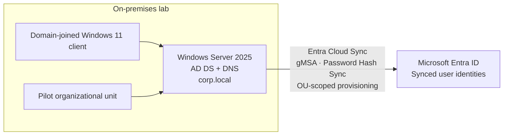
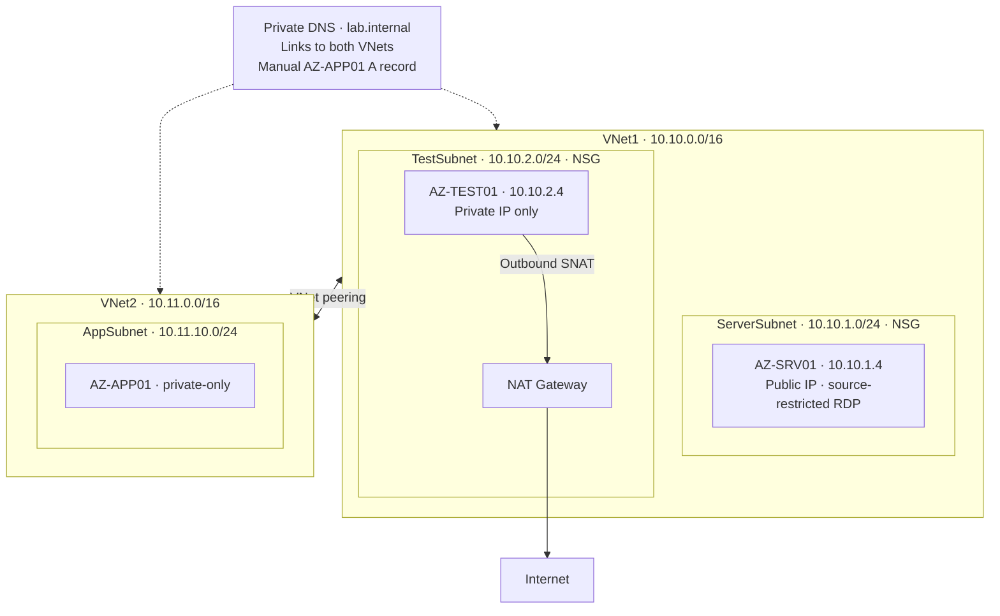

# Enterprise Infrastructure Lab

**Windows Server 2025 · Active Directory · Microsoft Entra ID · Azure Networking · Security**

Hands-on enterprise infrastructure lab spanning on-premises Windows identity and Microsoft Azure. Focused on deployment, access control, network segmentation, hybrid identity, and systematic troubleshooting.

> **Status:** Active lab. Logical diagrams represent documented configurations, not a production environment or a live Azure export.

## Architecture

### Hybrid identity

### Azure network

*Hybrid identity synchronization does not imply an on-premises-to-Azure VPN or private network connection.*

## What I implemented

| Domain | Implementation |
|---|---|
| Windows identity | Windows Server 2025 DC, `corp.local`, AD DS, DNS, domain-joined Windows 11 client, OUs and groups |
| Group Policy | Password and account lockout policies; standard-user restrictions |
| Hybrid identity | Entra Cloud Sync provisioning agent, gMSA, password hash synchronization, pilot OU scoping |
| Azure compute | Windows Server VMs in segmented subnets, private addressing, restricted RDP |
| Networking | Two VNets, subnet NSGs, NAT Gateway, peering, private DNS, route-table experiments |
| Diagnostics | Network Watcher Next Hop, IP Flow Verify, Connection Troubleshoot; PowerShell and Windows network tools |

## Troubleshooting and validation

| Scenario | Diagnostic approach | Observed result |
|---|---|---|
| Inter-subnet ping failure | `Test-NetConnection` TCP/3389 and Windows Firewall inspection | RDP reachable; ICMP succeeded after guest firewall rule change |
| Azure deployment denied | Activity Log and Azure Policy | Found allowed-region restriction; redeployed in North Central US |
| Entra Cloud Sync provisioning errors | Provisioning logs, OU scope and distinguished names | Corrected scoping; pilot user synchronized |
| Private VM lacked Internet egress | NAT Gateway association and external IP verification | AZ-TEST01 retained private IP; outbound used NAT public IP |
| Test UDR disrupted RDP | Effective routes, `10.10.1.0/24 → None` | Identified broken return path; removed test UDR and restored access |
| Cross-VNet DNS resolution failure | Verified TCP reachability separately from DNS | Linked private DNS zone and added A record; name resolution succeeded |

## Engineering decisions

- **Least-exposed management:** allowed public RDP to AZ-SRV01 only from the administrator's current public IP.
- **Private workloads:** AZ-TEST01 and AZ-APP01 have no dedicated public IP; NAT Gateway provides AZ-TEST01 outbound egress.
- **Layered diagnostics:** distinguished Azure routing, NSGs, Windows Firewall, DNS, and service availability.
- **Scoped rollout:** synchronized a pilot OU before broader hybrid identity expansion.

## Roadmap

Planned, **not yet claimed as implemented**: Azure storage, monitoring/logging, backup/recovery, and hybrid device management.

*Supporting configuration screenshots and validation evidence are documented in a separate internal wiki. The full wiki is intentionally excluded from this public repository; sanitized screenshots may be added under `docs/evidence/`.*
